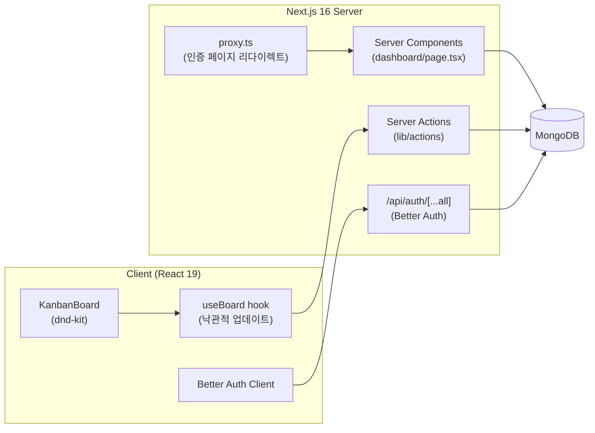
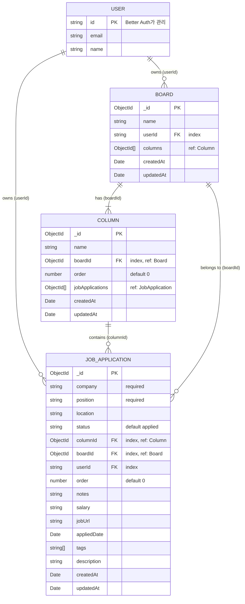

# Job Application Tracker
 
구직 활동을 칸반 보드로 관리하는 풀스택 웹 애플리케이션입니다.
지원한 회사를 **Wish list → Applied → Interviewing → Offer → Rejected** 단계별로 정리하고, 카드를 드래그 앤 드롭으로 옮기며 진행 상황을 추적할 수 있습니다.
 
🔗 **Live Demo**: [job-application-tracker-iro-nomad.vercel.app](https://job-application-tracker-iro-nomad.vercel.app)
 
---
 
## 📌 프로젝트 개요
 
| 항목 | 내용 |
| --- | --- |
| 프로젝트 유형 | 개인 프로젝트 (풀스택) |
| 목적 | 흩어지기 쉬운 지원 현황을 한 화면에서 관리 |
| 핵심 기능 | 회원가입/로그인, 칸반 보드, 드래그 앤 드롭 이동·정렬, 지원 카드 생성, 컬럼 이름 수정 |
| 배포 | Vercel |
| 패키지 매니저 | pnpm |
 
---
 
## 🛠 기술 스택
 
### Frontend
| 기술 | 버전 | 사용 목적 |
| --- | --- | --- |
| **Next.js** (App Router) | 16.3.5 | 풀스택 프레임워크, 서버 컴포넌트, Server Actions |
| **React** | 19.2.8 | UI 라이브러리 |
| **TypeScript** | 5 | 정적 타입 |
| **Tailwind CSS** | 4 | 유틸리티 기반 스타일링 (`@tailwindcss/postcss`) |
| **shadcn/ui** (`base-nova` 스타일) + **@base-ui/react** | shadcn 4.21 / base-ui 1.8 | 접근성을 갖춘 UI 컴포넌트 (Button, Card, Dialog, Dropdown 등) |
| **class-variance-authority**, **tw-animate-css** | - | 컴포넌트 변형 관리, 애니메이션 |
| **lucide-react** | 1.47 | 아이콘 |
| **@dnd-kit** (core / sortable / utilities) | 6.3 / 10.0 / 3.2 | 칸반 드래그 앤 드롭 |
| **next/font** (Geist, Geist Mono) | - | 폰트 최적화 |
 
### Backend
| 기술 | 버전 | 사용 목적 |
| --- | --- | --- |
| **Next.js Server Actions** | - | 별도 REST API 서버 없이 서버 로직 처리 (`"use server"`) |
| **Better Auth** | 1.7.5 | 이메일/비밀번호 인증, 세션 관리 |
| **MongoDB** | driver 7.6 | NoSQL 데이터베이스 |
| **Mongoose** | 9.10 | ODM, 스키마 정의 및 관계(populate) |
 
### Tooling & Deployment
| 기술 | 용도 |
| --- | --- |
| **ESLint 9** + `eslint-config-next` | 코드 품질 |
| **tsx** | 시드 스크립트 실행 (`pnpm seed:jobs`) |
| **pnpm** | 패키지 관리 |
| **Vercel** | 배포 |
 
---
 
## 🏗 아키텍처
 
별도의 API 서버를 두지 않고 **Next.js 하나로 프론트엔드와 백엔드를 구성**했습니다.
데이터 변경은 Server Actions로, 인증 엔드포인트는 Better Auth의 Route Handler로 처리합니다.
 

 
### 요청 흐름 (카드를 다른 컬럼으로 옮길 때)
 
1. `@dnd-kit`의 `onDragEnd`에서 드롭 위치(컬럼 / 카드)를 계산
2. `useBoard.moveJob()`이 **클라이언트 상태를 먼저 갱신**해 즉시 화면에 반영 (낙관적 업데이트)
3. 이어서 `updateJobApplication` Server Action을 호출해 DB에 저장
4. 서버에서 세션·소유자를 검증하고 컬럼/순서를 갱신한 뒤 `revalidatePath("/dashboard")`
---
 
## 🗂 ERD
 
MongoDB를 사용하지만 **Board → Column → JobApplication**의 계층 관계를 ObjectId 참조로 모델링했습니다.
사용자 정보는 Better Auth가 관리하며, 앱 컬렉션은 `userId`(문자열)로 사용자를 참조합니다.
 

 
### 스키마 설계 포인트
 
- **양방향 참조**: `Board.columns`, `Column.jobApplications` 배열로 부모→자식 조회를 빠르게 하고, 자식 문서에도 `boardId` / `columnId`를 두어 자식→부모 조회와 소유권 검증이 가능하도록 했습니다.
- **인덱스**: 조회 조건으로 자주 쓰이는 `userId`, `boardId`, `columnId`에 인덱스를 추가했습니다.
- **정렬 필드 `order`**: 컬럼과 카드의 표시 순서를 숫자로 저장합니다. (아래 [카드 정렬 방식](#카드-정렬-방식) 참고)
- **타임스탬프**: 모든 모델에 Mongoose `timestamps: true`를 적용했습니다.
- **모델 재등록 방지**: `mongoose.models.X || mongoose.model(...)` 패턴으로 개발 환경의 핫 리로드 시 모델 중복 등록 오류를 방지했습니다.
- **사용자 컬렉션 분리**: 인증 관련 컬렉션은 Better Auth의 MongoDB 어댑터가 관리하고, 앱 도메인 모델과는 `userId` 문자열로만 연결했습니다.
---
 
## ✨ 구현 내용
 
### 1. 인증 (Better Auth)
 
- 이메일/비밀번호 로그인을 사용하고, `/api/auth/[...all]` Route Handler로 인증 요청을 처리합니다.
- **Mongoose가 만든 MongoDB 연결(client)을 Better Auth의 `mongodbAdapter`가 그대로 재사용**하도록 구성해 연결을 하나로 유지했습니다.
- 세션 쿠키 캐시(`cookieCache`, 1시간)를 켜서 매 요청마다 DB를 조회하지 않도록 했습니다.
- **회원가입 직후 훅**(`databaseHooks.user.create.after`)에서 `initializeUserBoard()`를 호출해, 신규 사용자에게 `Job Hunt` 보드와 기본 컬럼 5개(Wish list, Applied, Interviewing, Offer, Rejected)를 자동 생성합니다. 이미 보드가 있으면 새로 만들지 않습니다.
- `proxy.ts`에서 이미 로그인한 사용자가 `/sign-in`, `/sign-up`에 접근하면 `/dashboard`로 리다이렉트합니다.
- 클라이언트에서는 `createAuthClient`로 `signIn`, `signUp`, `signOut`, `useSession`을 사용합니다.
### 2. 칸반 보드 & 드래그 앤 드롭 (@dnd-kit)
 
- `DndContext` + `closestCorners` 충돌 감지, `PointerSensor`로 입력을 처리합니다.
- 컬럼은 `useDroppable`, 카드는 `useSortable` + `verticalListSortingStrategy`로 구성해 **컬럼 간 이동과 같은 컬럼 내 재정렬**을 모두 지원합니다.
- `DragOverlay`로 드래그 중인 카드를 별도 레이어에 렌더링합니다.
- 드롭 대상이 컬럼 영역인지, 다른 카드 위인지에 따라 **목표 인덱스를 계산**하는 로직을 `handleDragEnd`에 구현했습니다.
### 3. 낙관적 업데이트 (`useBoard` 커스텀 훅)
 
- 서버 응답을 기다리지 않고 클라이언트 상태(`columns`)를 먼저 변경해 드래그 직후 UI가 즉시 반영됩니다.
- 보드와 컬럼 상태를 훅 안에 캡슐화해 `KanbanBoard` 컴포넌트는 `moveJob(jobId, newColumnId, newOrder)`만 호출하면 됩니다.
### 4. 카드 정렬 방식
 
카드 순서를 `order` 숫자 필드로 관리하며, **인덱스 × 100** 간격으로 저장합니다.
 
- 새 카드는 해당 컬럼의 최대 `order` + 1로 생성됩니다.
- 이동/재정렬 시에는 영향을 받는 카드들의 `order`를 ±100씩 이동시킵니다.
- 컬럼을 옮길 때는 이전 컬럼의 `jobApplications`에서 `$pull`, 새 컬럼에 `$push`로 참조 배열도 함께 갱신합니다.
### 5. Server Actions & 권한 검증
 
| Action | 위치 | 역할 |
| --- | --- | --- |
| `createJobApplication` | `lib/actions/job-applications.ts` | 지원 카드 생성 |
| `updateJobApplication` | `lib/actions/job-applications.ts` | 정보 수정, 컬럼 이동, 순서 변경 |
| `deleteJobApplication` | `lib/actions/job-applications.ts` | 지원 카드 삭제 (컬럼 참조도 함께 제거) |
| `updateColumn` | `lib/actions/columns.ts` | 컬럼 이름 수정 |
 
- 모든 Action은 서버에서 `getSession()`으로 **로그인 여부를 먼저 확인**합니다.
- 카드 생성 시 `Board.findOne({ _id, userId })`로 **보드 소유권**을, `Column.findOne({ _id, boardId })`로 **컬럼이 해당 보드에 속하는지** 검증합니다.
- 카드 수정/삭제 시에는 문서의 `userId`와 세션 사용자 ID를 비교해 **타인의 데이터 접근을 차단**합니다.
- 변경 후 `revalidatePath("/dashboard")`로 서버 캐시를 갱신합니다.
### 6. 데이터 조회와 캐싱 (Next.js 16)
 
- `next.config.ts`에서 `cacheComponents: true`를 활성화하고, 대시보드의 `getBoard()`에 `"use cache"` 지시어를 적용했습니다.
- 보드 조회는 `populate`를 중첩(`columns` → `jobApplications`)해 **한 번의 쿼리 흐름으로 보드 전체를 로딩**합니다.
- 인증 정보처럼 요청마다 달라지는 부분은 `<Suspense>`로 감싸 로딩 상태를 처리합니다.
- Mongoose 문서는 `JSON.parse(JSON.stringify(...))`로 직렬화한 뒤 클라이언트 컴포넌트에 전달합니다.
### 7. DB 연결 관리 (`lib/db.ts`)
 
- 서버리스/핫 리로드 환경에서 연결이 중복 생성되지 않도록 `global.mongoose`에 **연결과 Promise를 캐싱**합니다.
- `bufferCommands: false`로 연결 전 명령이 쌓이지 않게 하고, 연결 실패 시 캐시된 Promise를 초기화해 재시도할 수 있게 했습니다.
### 8. 시드 스크립트
 
- `scripts/seed.ts`로 샘플 지원 내역 15건을 컬럼별로 분배해 생성합니다. (`pnpm seed:jobs`)
- 개발 중 UI 확인과 데모 데이터 구성에 활용할 수 있습니다.
---
 
## 📁 프로젝트 구조
 
```
job-application-tracker
├── app
│   ├── api/auth/[...all]/route.ts   # Better Auth 핸들러
│   ├── dashboard/page.tsx           # 보드 조회 (Server Component, use cache)
│   ├── sign-in/page.tsx             # 로그인
│   ├── sign-up/page.tsx             # 회원가입
│   ├── layout.tsx                   # 공통 레이아웃 (Navbar, Geist 폰트)
│   ├── page.tsx                     # 랜딩 페이지
│   └── globals.css
├── components
│   ├── kanban-board.tsx             # 칸반 보드 + DnD 로직
│   ├── create-job-app-dialog.tsx    # 지원 카드 생성 다이얼로그
│   ├── edit-column-dialog.tsx       # 컬럼 이름 수정 다이얼로그
│   ├── image-tabs.tsx               # 랜딩 페이지 이미지 탭
│   ├── Navbar.tsx
│   └── ui/                          # shadcn/ui 컴포넌트 + job-application-card
├── lib
│   ├── actions/                     # Server Actions (columns, job-applications)
│   ├── auth/                        # Better Auth 서버/클라이언트 설정
│   ├── hooks/useBoards.ts           # 보드 상태 & 낙관적 업데이트 훅
│   ├── models/                      # Mongoose 모델 (board, column, job-application)
│   ├── db.ts                        # MongoDB 연결 캐싱
│   └── init-user-board.ts           # 신규 사용자 기본 보드 생성
├── scripts/seed.ts                  # 샘플 데이터 시드
├── proxy.ts                         # 인증 상태에 따른 라우트 리다이렉트
└── next.config.ts
```
 
---
 
## 🔑 환경 변수
 
| 변수 | 설명 |
| --- | --- |
| `MONGODB_URI` | MongoDB 연결 문자열 |
| `NEXT_PUBLIC_BETTER_AUTH_URL` | Better Auth 클라이언트가 사용하는 기본 URL |
